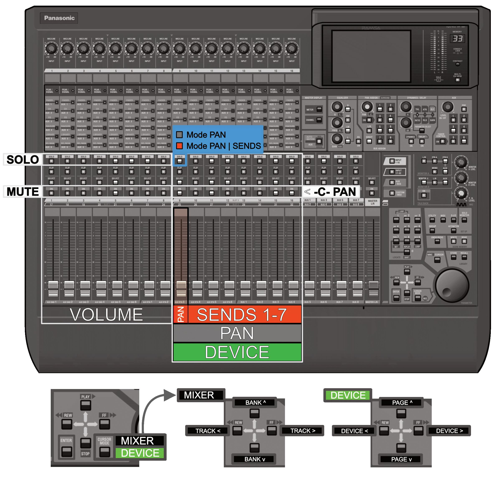
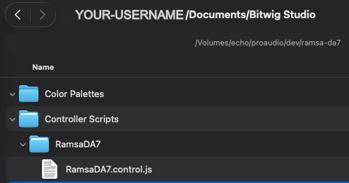
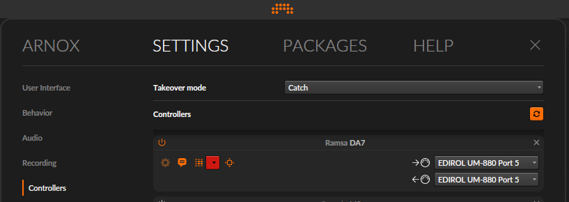
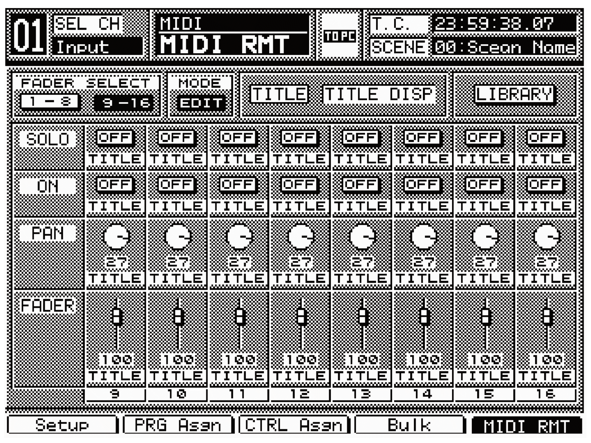
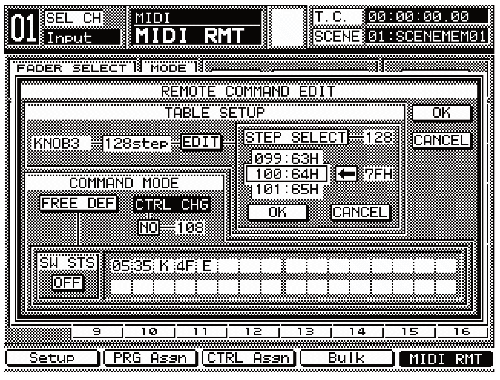

# Ramsa DA7 Bitwig Studio Controller

**Script version:** 0.8.0  
**Bitwig Controller API:** 18  
**Controller definition:** Ramsa / DA7  
**Script file:** `RamsaDA7.control.js`

## Overview

**The Ramsa DA7 Bitwig Studio controller script provides bidirectional feedback and control of mixer volume, pan, sends and device remote controls.**

The script expects the DA7 to send MIDI CC messages for its faders and buttons, and those require CC configuration on the DA7. It also sends MIDI CC feedback back to the DA7 so motorized faders and button LEDs reflect Bitwig's values.

This script will turn your Ramsa DA7 into an extremely powerful Bitwig control surface.

## TLDR; For experienced users
If you know your way around the DA7 and Bitwig, getting this running is a somple two-step process:
 1. Copy the 'RamsaDA7.control.js' script to Bitwig's "Controller Scripts" folder, add the Ramsa DA7 controller, and set its MIDI in/out channels.
 2. Configure the DA7's MIDI RMT pages with the corresonding CC values.

## Main controls

### IMPORTANT

- Set the DA7 to **MMC** mode (*use the MMC/CURSOR button*) and **CUSTOM/MIDI** layer.
- Use the **CURSOR/MIDI** button to switch Bitwig control between **MIXER** and **DEVICE** mode.

### Faders 1–8: track volume

- Control the volume of the eight tracks in the current Bitwig track bank.
- Follow the current bank as the track bank scrolls.
- When `SELECT_TRACK_ON_FADER_TOUCH` is enabled (the default), moving a volume fader also selects that track in Bitwig. This is useful because the sends and device controls follow the selected/cursor track.
- The script sends volume feedback to the DA7.

### Faders 9–16: auxiliary controls

Faders 9–16 have two mixer modes, selected with the DA7's **Solo 9** button (CC 58).

**Pan mode (default)**

| DA7 fader | Bitwig control |
|---|---|
| 9 - 16 | Pan of track 1 - 8 in the current bank |

**Pan + Sends mode**

| DA7 fader | Bitwig control |
|---|---|
| 9 | Pan of the selected/cursor track |
| 10 - 16 | Send 1 - 7 of the selected/cursor track |

The script exposes up to seven sends in this mode. A send fader only controls a send that exists on the selected track; the controller does not create sends or assign them to destinations.

The Solo 9 LED is used as a mode indicator: dark for Pan mode and lit for Pan + Sends mode.

### Mute buttons: track mute

- Mute buttons 1–8 control mute for the eight tracks in the current bank.
- The script deliberately drives the DA7 mute LEDs **on when the track is audible** and **off when the track is muted**, matching the behavior noted in the code.
- Mute buttons continue to work while Device Mode is active.

### Solo buttons 1–8: track solo

- Solo buttons 1–8 control solo for the eight tracks in the current bank.
- Their LEDs follow Bitwig's solo state.
- Solo buttons 1–8 are not repurposed in Device Mode.

### Mute buttons under faders 9–16: reset auxiliary parameter

These eight buttons are used as **reset buttons**, not as track mutes:

- In Pan mode, each resets the corresponding track's pan.
- In Pan + Sends mode, button 9 resets the selected track's pan; buttons 10–16 reset sends 1–7.
- In Device Mode, each resets the corresponding device remote-control parameter.
- The script forces these LEDs back off after a press.

### Device Mode

Device Mode maps faders 9–16 to the first eight remote-control parameters of the selected Bitwig device's currently selected remote-controls page.

- Toggle Device Mode using the DA7's MMC/CURSOR button.
- In Device Mode, faders 1–8 still control track volume.
- The auxiliary reset buttons reset device parameters.
- The script asks Bitwig to show/toggle the device panel when entering Device Mode, and the mixer panel when leaving it.
- The script displays popup notifications for mode and remote-control page/device-name changes.

### Navigation

The script listens for these exact MMC-style SysEx messages:

| DA7 navigation action | SysEx bytes | In Mixer Mode | In Device Mode |
|---|---|---|---|
| Left  | Select previous cursor track | Select previous device |
| Right  | Select next cursor track | Select next device |
| Up  | Scroll to previous track-bank page | Select previous remote-control page |
| Down | Scroll to next track-bank page | Select next remote-control page |
| Mode toggle | Enter Device Mode | Return to Mixer Mode |

The script also calls `refreshSurface()` after navigation so the faders are sent updated positions.

## Required Ramsa DA7 configuration

The DA7 must send the CC numbers expected by the script. In the DA7's **MIDI Remote configuration** (wording may vary by firmware), assign the following CC IDs to the corresponding physical controls.

| DA7 control | CC number(s) | Purpose |
|---|---:|---|
| Faders 1–8 | 0–7 | Track volume |
| Faders 9–16 | 8–15 | Pan, sends, or device parameters |
| Mute buttons 1–8 | 33–40 | Track mute |
| Mute buttons 9–16 | 41–48 | Reset the auxiliary/device parameter under each fader |
| Solo buttons 1–8 | 50–57 | Track solo |
| Solo button 9 | 58 | Toggle Pan / Pan + Sends mode |

**Important:** CC 41–48 is the eight-button range actually handled by the code (`CC_AUX_MUTE_FIRST = 41` plus eight controls). The opening comment in the script says `CC 41–47`, which omits the eighth control; configure **41–48** for the full set of reset buttons.

### MIDI channel

The default is MIDI channel index `0`, which is MIDI **Channel 1** in the usual human-readable numbering.

- Configure the DA7 to transmit the controls on MIDI Channel 1.
- Ensure Bitwig's controller input/output ports point to the DA7's MIDI input and output.
- If the DA7 uses another channel, change `CONFIG.MIDI_CHANNEL` in the script to the corresponding zero-based channel index (`0`–`15`). Set it to `-1` to accept CC messages on all input channels. Output feedback still uses the configured output channel; with `-1`, the script outputs on Channel 1.

### Fader feedback and MIDI output

The script sends CC values back to the DA7 for fader positions and button indicators. Connect/configure the DA7's MIDI input and output in Bitwig so that:

- DA7 MIDI output reaches Bitwig's controller input.
- Bitwig controller output reaches the DA7's MIDI input.
- MIDI feedback is enabled and not blocked by a DA7 setting, MIDI interface routing, or another application.

The script uses a 7-bit value range (0–127). It avoids resending unchanged values and temporarily blocks fader feedback for 200 ms after a physical fader move to reduce MIDI echo/fighting. A forced refresh occurs when changing modes so the faders update to the newly assigned parameters.

## Install and set up in Bitwig Studio

1. **Save the script** as `RamsaDA7.control.js`.
2. **Place it in Bitwig's user controller-script directory.** On macOS, this is typically under the Bitwig Studio user directory in `Documents/Bitwig Studio/Controller Scripts/`; create a folder such as `Ramsa DA7` and put the file inside. If your Bitwig version uses a different user-data location, use that version's Controller Scripts directory.

3. **Restart Bitwig Studio** or refresh the controller-script list if your version supports it.
4. Open **Settings → Controllers** and add the **Ramsa DA7** controller if it appears in the available controller list.

5. Select the DA7's MIDI input and MIDI output ports for the controller.
6. Configure the DA7 CC assignments according to the tables above, and verify it is transmitting on MIDI Channel 1 unless the script has been changed.
7. Confirm the DA7 can receive MIDI feedback from Bitwig.
8. Test in a project with at least eight tracks. For send mode, make sure the selected track has the sends you intend to control. For Device Mode, select a device with useful remote controls/pages configured in Bitwig.

## Configuration values in the script

These settings are defined near the top of `RamsaDA7.control.js`:

| Setting | Default | Effect |
|---|---:|---|
| `MIDI_CHANNEL` | `0` | Accept input on MIDI Channel 1; `-1` accepts all input channels |
| `CC_VOLUME_FIRST` | `0` | Start CC for faders 1–8 |
| `CC_AUX_FIRST` | `8` | Start CC for faders 9–16 |
| `CC_TRACK_MUTE_FIRST` | `33` | Start CC for mute buttons 1–8 |
| `CC_AUX_MUTE_FIRST` | `41` | Start CC for reset buttons 9–16 |
| `CC_SOLO_FIRST` | `50` | Start CC for solo buttons 1–8 |
| `CC_AUX_MODE_TOGGLE` | `58` | Solo 9 mode-toggle CC |

On the Ramsa DA7, you will set these values using these two pages:

Make sure that you're in 'EDIT' mode, so that entering a control will bring up its configuration page:

The controller's track bank has eight channels and follows Bitwig's cursor track. The code also creates a scene bank and enables clip-launcher indication on the first track's clip slots, but it does not define a dedicated set of clip-launch buttons.

## Troubleshooting

### DA7 is not controlling Bitwig
- MIDI channels and CC configuration are the most likely culprit. Use a tool like [Protokol](https://hexler.net/protokol) to confirm that your computer is receiving correct CC messages from the DA7.
- If correct MIDI CCs are received, do you have a Ramsa DA7 controller in Bitwig configured with correct MIDI channels? If not, Bitwig isn't reading/finding the controller script file.
- If all of the above are true, and still no luck, restart Bitwig, reboot, and retrace your steps.

### Faders move but Bitwig parameters do not change
- Check that the DA7 CC numbers match the table ranges and values.
- Check that the DA7 is transmitting on Channel 1, or adjust `MIDI_CHANNEL`.
- Confirm the correct DA7 MIDI input port is selected in Bitwig.
- Confirm the fader's current mode: Pan mode, Pan + Sends mode, or Device Mode.

### Bitwig values change but DA7 faders/LEDs do not follow
- Check the DA7 MIDI input/feedback path from Bitwig's output port.
- Verify the DA7 accepts incoming CC feedback for the same CC IDs.
- Check for MIDI routing loops or another application using the ports.

### Buttons work only on alternate presses
- The script defaults to latching-button behavior (`BUTTONS_ARE_LATCHING: true`). If the DA7 sends separate press and release messages, set it to `false`.

### Mute LED appears backwards
- The script intentionally lights the DA7 mute LED when the Bitwig track is audible and turns it off when muted. This is explicitly documented in the source code. If your DA7's LED convention differs, adjust the values in `setupTracks()`.

### Pan + Sends mode has no send controls
- The selected/cursor track must have sends available in Bitwig.
- Fader 9 is reserved for the selected track's pan; only faders 10–16 control sends 1–7.
- The script does not create sends or choose their destinations.

### Device Mode navigation does not work
- Verify the DA7 sends the specified SysEx messages, not ordinary CC messages, for its mode and arrow/navigation controls.
- Confirm a device is selected and has remote-control pages available in Bitwig.
- The script recognizes the exact message byte sequences listed above.

### Transport does not respond
- Assign CC 110–114 to the transport controls.
- Confirm the incoming values cross the on threshold (64 by default).
- Set a transport CC to `-1` in the script to disable that action if it conflicts with another mapping.

## Notes and limitations

- The script exposes eight tracks at a time; use track-bank navigation to move to other tracks.
- Faders 1–8 always remain track volume, including Device Mode.
- The auxiliary bank has eight faders, but Pan + Sends mode uses one for pan and seven for sends.
- Device Mode controls the first eight parameters on the selected remote-control page, not every parameter on the device at once.
- Exact DA7 menu names can vary by firmware. The CC numbers, channel, button-message style, and SysEx messages above are the requirements inferred directly from this controller script; verify the DA7's actual transmitted messages if behavior differs.
